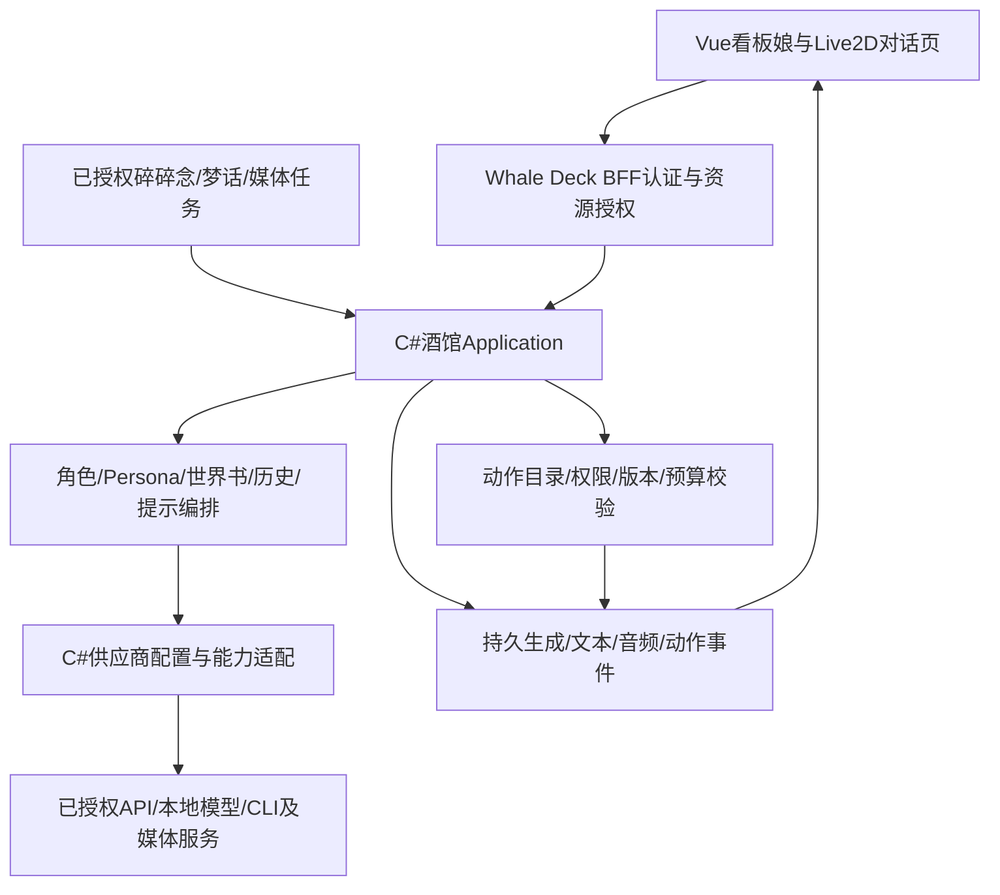

# 统一模型供应商、酒馆编排与 AI 驱动 Live2D

日期：2026-10-30。用户继续明确：看板娘的对话等AI功能全部接入Whale Deck酒馆；酒馆参考Cindy模型供应商配置来获得AI能力；看板娘对话页面使用Live2D，动作由AI控制。

**状态：已补充当前计划，待实现及实际模型/Live2D/页面验收。** 本轮只读核对Cindy帮助/公共源码与Live2D官方文档，没有读取或迁移Cindy实际账户/密钥、修改Cindy设置、发起模型请求、下载SDK/模型或部署应用。此设计细化[现有C#酒馆方案](AI_TAVERN_MASCOT.md)，保留59个主任务、272个ST和6个PET父级验收ID，新增的PROVIDER/L2D细目是这些条目的子门槛，不恢复计费平台/多节点/通用插件生态。

## 1. 固定事实与本项目决定

| 核实来源 | 事实 | 本项目如何采用 |
| --- | --- | --- |
| Cindy当前帮助 `get_capabilities(scope=help,key=providers)`，并对照[固定帮助文件](https://github.com/makecindy/cindy/blob/08c0a10621f976ac77ce468fb76382119a28c0e7/apps/desktop/help-knowledge/providers.md) | 供应商集中配置；选择供应商→连接→选择模型；自定义兼容服务、模型发现/连通测试、逐模型及供应商启停；余额/额度与凭据动作有独立入口 | 在Whale Deck内建立集中供应商配置和模型目录，为酒馆提供能力。参考其产品/配置机制，不依赖Cindy进程在线，也不自动获得Cindy官方服务账户授权 |
| Cindy[types](https://github.com/makecindy/cindy/blob/08c0a10621f976ac77ce468fb76382119a28c0e7/packages/model-providers/src/types.ts)、[user-provider](https://github.com/makecindy/cindy/blob/08c0a10621f976ac77ce468fb76382119a28c0e7/packages/model-providers/src/user-provider.ts)、[unifiedSelection](https://github.com/makecindy/cindy/blob/08c0a10621f976ac77ce468fb76382119a28c0e7/packages/model-providers/src/unifiedSelection.ts) | 区分来源、认证方式、协议/运行时、模型实际wire ID、启用状态和能力；API key不由普通目录派生代码注入 | C#内分开建模供应商、连接、模型、能力、用途绑定与Secret引用；模型显示名不能代替实际调用ID，不能从OAuth/API-key推断订阅或现金余额 |
| Cindy[custom-provider-header-secrets](https://github.com/makecindy/cindy/blob/08c0a10621f976ac77ce468fb76382119a28c0e7/apps/desktop/src/main/maker-host/custom-provider-header-secrets.ts)、[custom-provider-store](https://github.com/makecindy/cindy/blob/08c0a10621f976ac77ce468fb76382119a28c0e7/apps/desktop/src/main/maker-host/custom-provider-store.ts) | 自定义请求头值从普通配置剥离至owner范围safeStorage；读取失败有unknown状态；连接/路由有校验 | 服务端Secret存储取代Electron safeStorage，不把Cindy桌面SQLite/密码库搬入产品；配置保存失败不丢旧凭据，不把无法解密当未配置 |
| Cindy[modelInterfaceContract](https://github.com/makecindy/cindy/blob/08c0a10621f976ac77ce468fb76382119a28c0e7/packages/model-providers/src/modelInterfaceContract.ts) | 接口契约约束凭据来源，不能跨origin绑定 | 模型发现/测试/推理/余额的目的端分别审核，禁止凭据随任意模型路由或重定向外流；本机loopback与Docker内部地址语义不能直接照搬 |
| Live2D官方[Motion](https://docs.live2d.com/en/cubism-sdk-manual/motion/)、[Expression](https://docs.live2d.com/en/cubism-sdk-manual/expression/) | SDK播放预制动作/表情并逐帧更新；优先级仲裁需要应用实现 | AI选择语义动作/表情，C#校验，Vue/TS在浏览器驱动SDK；不要求模型逐帧生成参数或直接操纵WebGL |
| Live2D官方[Physics](https://docs.live2d.com/en/cubism-sdk-manual/physics/)、[Lip-sync](https://docs.live2d.com/en/cubism-sdk-manual/lipsync/) | 物理用模型的.physics3.json；口型可由音频信号驱动 | 角色局部物理与整个宠物拖拽/抛掷分层处理；真实TTS音频驱动口型，静音/失败不伪造已播语音 |

固定Cindy公共源码提交为 `08c0a10621f976ac77ce468fb76382119a28c0e7`，不是已安装应用版本证明；官方Live2D文档为本日滚动页面，不等于已锁定/测试SDK版本。本轮没有验证Cindy所有供应商或Live2D运行效果。Cindy账户共享、商业余额充值、三引擎自动选择和跨设备运行不是本项目此次要求，不能整套搬入而恢复已移出主任务。

## 2. 唯一调用链与职责



看板娘是酒馆的一个交互入口，不另建“pet专用LLM直连”。聊天、碎碎念、梦话、总结、翻译、视觉、配图、语音、情绪/动作决策等使用酒馆Application的按用途服务，再由统一供应商配置解析实际能力。embedding/转换/语音等按其任务处理，不强行套入角色对话的全部提示；它们仍复用同一连接/能力/Secret/授权/预算与失败记录。

用户只选择被授权的供应商/模型配置引用。浏览器和pet包不能携带服务URL/API key/任意请求头；角色人设、世界书、快捷回复和扩展也不能绕过解析器选择私有连接。余额查询通过该供应商的真实余额/额度适配器完成，不能交给语言模型推测。离线的呼吸、眨眼、拖拽与待机是本地动画规则，不伪称发起过AI调用。

此前Codex CLI方向继续作为供应商连接类型之一，专用隔离运行域与实际授权验证保留；不能让它成为看板娘第二条直连通道，也不能把接通CLI认定语音/视觉/embedding/全部采样可用。供应商适配不拥有酒馆角色或聊天历史的第二份权威数据。

## 3. 供应商配置、用途绑定与页面

设计入口：`PAGE-AI-006`中的 `/settings/ai/providers`；`PAGE-AI-004`选择这些连接及模型，`PAGE-PET-001`只选择用途绑定。路径是待实施设计，没有注册假菜单。

| 配置对象 | 字段与行为要求 |
| --- | --- |
| Provider | 稳定ID、显示名、owner/实例配置作用域、来源、启停/版本、顺序、授权范围；显示名重复时仍可准确区分身份 |
| Connection | API/本地服务/经支持的授权或CLI类型，认证方式、Secret引用、受审查base URL/模型发现地址/协议、超时/并发/出站策略；请求头值全部按Secret管理 |
| Model | 稳定内部ID、真实wireModelId、连接及协议、显示名、启停、来源/发现时间、能力与真实测试状态；手动模型不伪称已被供应商发现 |
| Capability | Chat/Text/Responses/其他受支持协议，流式/取消、结构化输出/工具、视觉、embedding、TTS/STT、绘图、tokenizer/采样/reasoning等；Unknown/Unsupported/Verified明确区分 |
| Purpose binding | `chat/whisper/sleepTalk/summary/translation/vision/embedding/image/tts/stt/motion`等用途→授权模型引用及版本/预算；可以分别选模型，仍从统一目录取数 |
| Connection profile | ST连接预设组合供应商/模型引用与采样/模板/tokenizer等，不复制密钥或再建一套模型列表；模型目录更新不偷偷改变已冻结生成 |
| Secret与状态 | UI只返回configured/unknown/expired等状态与引用，值不回显/不提供复制明文；轮换/重新授权/删除/断开分别说明影响，恢复失败保留有效旧配置 |
| Usage与余额 | 按生成记录实际供应商/模型/用途和已返回用量；余额/点数/窗口额度类型、单位/采样/重置/未知明确，不新增平台收款或用户结算 |

页面参考Cindy的供应商列表+详情和三步添加：选择类型→设置连接与认证→发现/手填并选择模型。提供模型筛选/能力/启停、重命名/禁用/删除、连通性测试与用途默认配置；手机变为可返回的分栏顺序，沿用Element Plus明暗紧凑卡片。

模型发现不等于实际可用；连通测试和测试生成是显式动作，说明可能消耗额度，保存配置不暗中调用模型。供应商禁用后禁止新调用，历史消息和原供应商事实保留；在途调用按已冻结版本/安全取消或Unknown收尾，不能静默切到其他收费来源。删除前检查模型/预设/宠物/任务引用，返回可审阅影响与重新绑定方案；密钥轮换先验证安全存储成功，失败不破坏旧有效配置。

作用域沿用Authentik Subject：实例级连接由管理员配置与显式授予；本人连接管理需额外授予`PERM-AI-PROVIDER-EDIT-OWN`，不因可聊天而自动获得配置/导出密钥能力。共享连接只共享使用权限，不共享Secret原文；不增加团队/跨机器供应商分享平台。无认证仅适用于明确批准的隔离本地模型连接，不把任意内网匿名端点作为默认安全。

## 4. Live2D作为看板娘对话页必需呈现

`PAGE-PET-001`的完整对话页面必须具备Live2D舞台、可用的聊天记录/输入、生成与音频状态、角色/模型信息和可收起配置面板；快捷气泡与完整页面引用同一酒馆会话。对话页优先共享同一Live2D渲染实例/租约，避免浮层与舞台重复朗读或执行动作；切页/切角色/多标签/退出时释放旧实例并屏蔽旧事件。

本次决定覆盖此前“透明视频动画即可完成对话页”的设计；dsh-pet继续提供动作节奏/交互/物理/睡眠参考，视频仅作其他素材类型或明确的加载失败回退，不能替代正常Live2D验收。已有ST视频/立绘/VRM功能不删除，各自按原清单完成。

资源包至少包含已获授权的 `.model3.json`、`.moc3`、贴图和动作目录；按实际功能提供 `.motion3.json`、`.exp3.json`、`.physics3.json`、pose/眨眼/口型与命中区域定义。另有**语义动作目录**将 `greet/nod/think/happy/comfort/sleepStart/sleepLoop/wake` 等语义映射到本包实际资源；这些名称是设计示例，不声称zilii模型已有对应动作。缺少必须的动作或模型时明确缺依赖，不随机换成另一个角色。

C#服务端校验包结构/许可/摘要、有限路径/大小/纹理预算/资源清单和动作目录版本；受控存储提供授权资源。Vue/TS集成固定版本Cubism SDK for Web及Core，负责逐帧渲染/表情混合/视线/呼吸/眨眼/物理/命中测试；不把任意上传JS当角色包代码执行。Core/SDK/模型按各自许可和版本单独记录；[官方下载页](https://www.live2d.com/en/sdk/download/web/)提示Latest可能变化，生产不使用浮动CDN Latest，具体SDK/Core版本与摘要须在实施时锁定。

口型由已授权TTS生成的实际音频/时间轴驱动，AI只选择情绪/说话意图，不每帧输出嘴部参数。无TTS时保持文字聊天并标识未启用语音；若采用“说话动作”也不能标为已播放声音。WebGL丢失/不支持、纹理/动作缺失、音频权限或自动播放被阻止时显示具体状态，文字/停止按钮仍可用，重试不得重发原AI生成。

## 5. AI控制动作的结构化契约

AI必须能够依据实际对话选择动作/表情及语气变化，不能只由前端关键词或随机动画替代。两种供应商能力路径均进入同一校验器：

1. 支持工具调用时，酒馆向模型提供只读动作目录与`mascot.perform`工具schema；工具只控制当前已授权pet渲染，不带运维能力。
2. 不支持工具但能输出约束JSON时，酒馆要求独立结构化动作结果并完整解析。可以用同一供应商目录的专用`motion`模型，但必须显式配置、记录关联generation与额外消耗；默认不能每个token另发一次请求。

模型连这两种形式也不能可靠提供时，AI动作能力为不支持/未验证，保留本地待机和文字聊天，不宣称AI已控制动作。禁止解析普通聊天正文中的“点头”等字样就执行，也不将任意Markdown/隐藏思考作为指令。动作结果不作为可执行JSON原样显示在聊天正文。

下列是设计示例，不是现有API输出：

```json
{
  "version": 1,
  "action": "perform",
  "motionId": "greet",
  "expressionId": "happy",
  "intensity": 0.5,
  "durationMs": 1800,
  "anchor": "reply-start"
}
```

模型可提出目录ID、表达强度、时长和已声明的文本/音频段锚点。C#再生成`cueId/petId/conversationId/generationId/messageId/segmentId/packVersion/eventSeq/expiresAtUtc`等可信绑定；它们不由模型指定。服务端只接受当次目录内的动作/表情组合，限制数值/速率/时长/队列/递归轮数；非法或过多指令拒绝并记录稳定原因，文本回复可继续。不允许远程URL、文件路径、JavaScript、任意参数ID/SDK方法名或优先级穿透。参数混合、优先级和回退由受控适配器决定。

入库后通过同一生成事件通道发布`mascot-cue`，与文本/音频分类型并有序。浏览器二次核对会话/当前pet/包版本/期限/序号/授权和睡眠状态；完整指令验证后才执行，半段流式JSON不执行。`accepted`表示服务端接受、`renderer-started/completed/skipped/failed`是客户端观察回报，不能将Accepted伪装成看见动画，更不能作为真实运维动作已成功的证据。

AI只控制已存在的动作与表情，不即时生成新骨骼或新动作素材。基础眨眼/呼吸/鼠标跟随/碰撞由本地运行时完成，AI在其上提供语义意图；模型包物理与画布整体抛掷互不混用。

## 6. 仲裁、同步与故障恢复

- 应用安全/会话退出/模型包失败处置优先，其次用户隐藏/暂停/睡眠与直接拖拽，再是合法AI动作，最后待机随机动作；SDK保留priority不替代本项目仲裁。减少动画可拒绝大幅移动或改为轻表情，仍显示真实决策结果。
- 用户睡眠意图持久化。AI不能靠动作cue取消睡眠/唤醒或打开语音，梦话不执行动作；用户明确交互唤醒后才恢复。拟态睡姿与真正睡眠状态分开，AI请求不会绕过`UC-PET-004`规则。
- 同一`cueId`在当前播放租约内只执行一次；重连续读不能重复抛掷/朗读。历史消息回放默认不播旧动作，需要用户显式回放；过期/旧generation/旧包/切角色后的cue直接skipped。多标签/浮层与舞台由同一pet播放租约防止同时发声。
- 用户停止生成/退出/撤权/切角色后清除该生成待播cue并停止相关音频/动作，回到与持久睡眠意图一致的安全状态；晚到AI回复、WebGL恢复或TTS完成不得复活旧状态。远端取消未知仍如实记录，与本地停止展示分开。
- TTS音频起止/暂停/失败与表情/动作按segment时钟同步；没有可靠锚点时采用明确的reply-start/after-text策略，不承诺逐字同步。取消某段后停止关联cue，不以另一段音频误驱动旧口型。
- API/Worker重启恢复原生成和有限事件；页面重建只恢复当前状态及未过期可播cue，不重发模型请求。媒体下载/动作开始失败可重取同一资源，不重新生成回答；资源变更重新校验packVersion。

## 7. 需要补充的实体、用例和权限

| 标识 | 待实现契约 |
| --- | --- |
| DM-AI-PROVIDER / CONNECTION / MODEL / CAPABILITY / PURPOSE-BINDING | owner/授权/稳定ID与版本，Secret引用、目的端与协议、实际模型ID、启停、能力来源/测试时间；用途绑定及连接预设外键，生成冻结实际供应商/模型/绑定版本 |
| DM-PET-ACTION-CATALOG / CUE / PLAYBACK-LEASE | packVersion/实际资源摘要、语义动作和许可范围；cue关联原generation/message/segment、序号/期限/状态与拒绝原因；客户端回报与服务端事实分列，租约跨标签去重 |
| UC-AI-008 / UC-AI-009 | 供应商与模型生命周期/发现/显式测试/认证及安全存储；用途配置解析与生成前授权/能力/预算复核，不接受客户端任意端点 |
| UC-PET-005 / UC-PET-006 | 酒馆生成动作工具/结构化结果→C#完整校验/持久cue；事件读取/播放回报/取消/租约与恢复，所有权/原会话/版本绑定 |
| PERM-AI-PROVIDER-EDIT-OWN / PERM-AI-CONFIGURE-SERVICE | 本人连接管理须单独授权；实例级连接仍限管理员，允许使用连接不等于读取Secret |
| PERM-PET-ACTION-OWN | 原AI生成及pet资源同时授权，只控制本人当前渲染；只回报/读取本人cue，不能操作别人的pet或绕过睡眠 |

均须真实EF migration/PG约束、查询索引/并发版本/归属与保留策略。全文/提示/密钥不写通用日志；动作审计保存关联ID和安全语义摘要，不泄漏私有对话。播放租约和速率限制可用Valkey，但缓存丢失不能让同一模型请求再次扣费。NVMe运行、HDD备份包含配置引用/包/目录和必要状态；Secret仍走专用恢复通道。

## 8. 实施顺序与逐项验收

沿用DEV-AI-001..008，不另加主阶段：001补供应商/动作契约与模型包依赖→002实现统一供应商配置及酒馆调用→003接角色/提示与工具/结构化输出→004锁Live2D/TTS/媒体能力→006实现Live2D对话页与AI动作→007复用连接余额→008真实依赖/故障/页面与交付。006不等全部66扩展完成，但其所需模型/动作/媒体用例必须先可用，最终仍需完整ST/PET签收。

| 子验收 ID | 实际通过条件（当前均待实现/无验收） |
| --- | --- |
| AI-PROVIDER-001 | 真实供应商增改/启停/删除、模型发现/手填/测试/过滤和用途绑定；配置保存本身零推理，引用冲突可审阅 |
| AI-PROVIDER-002 | API/本地/首批CLI等实际启用类型分别验证；协议、wire ID与能力/来源正确，不能因目录列出即记已支持 |
| AI-PROVIDER-003 | 对话/碎碎念/梦话/总结/翻译/视觉/embedding/语音/绘图/动作决策按实际用途经过同一酒馆与配置解析；没有pet直连或重复模型目录 |
| AI-PROVIDER-004 | 匿名/未授权/跨用户/被撤权与配置管理拒绝；UI/日志/SQL/导出不含Secret和敏感头，未知凭据状态与轮换失败可恢复 |
| AI-PROVIDER-005 | 目的端/模型路由/发现/余额/重定向SSRF与凭据隔离；恶意角色卡/脚本不能改变连接地址或读取密钥 |
| AI-PROVIDER-006 | 超时/429/认证过期/停用/删除/模型下架/断线/重启/轮换及部分输出；原生成/用量/实际来源可追溯，不重复收费、不静默回退 |
| AI-PROVIDER-007 | 真实余额/额度/单位/窗口/未知和启停模型历史一致，多个用途共享轮询限额但不会越权共享个人余额 |
| AI-PROVIDER-008 | 真实Authentik→Vue配置→C#酒馆→实际模型链路，安装/升级/依赖锁/隔离恢复与来源版本一致 |
| PET-L2D-001 | 真正Live2D模型/Core/SDK/纹理/动作/表情/物理加载与版本/许可，缺依赖明确；正常对话页不以视频/静图替代 |
| PET-L2D-002 | 实际模型返回合法结构化动作，服务端校验后真实页面播放；根据不同对话有不同动作/表情，保留决策/cue/播放证据，不用固定夹具代替 |
| PET-L2D-003 | 工具及结构化输出能力分别测试，未支持路径诚实拒绝；恶意JSON/未知目录/任意脚本URL/越界数值/工具循环被阻止，文字聊天可继续 |
| PET-L2D-004 | 文本/动作/TTS按原generation/message/segment同步、真实音频驱动口型，停止/静音/自动播放拒绝/音频失败不残留旧口型或假已播 |
| PET-L2D-005 | 拖拽/视线/眨眼/角色物理/整宠抛掷、睡眠/梦话/唤醒、用户优先级与减少动画真实交互，无AI强制唤醒 |
| PET-L2D-006 | 刷新/重连/历史回放/多标签/切页/切角色/退出/撤权及后端重启不重播过期cue/朗读或重发模型；原cue与租约/终态可追溯 |
| PET-L2D-007 | WebGL上下文丢失/恢复、404/坏包/包版本变化/资源越界、隐藏页/手机旋转与持续运行；文字/停止入口保留，资源可恢复且无持续泄漏 |
| PET-L2D-008 | 320/1045/1440/1920px明暗/系统主题、键盘/触摸/焦点/读屏/减少动画，真实身份+模型+Live2D对话页全链截图/操作与独立状态证据 |

原272个ST/6个PET的条目不因以上细分变为已完成；这些子门槛映射ST-API/EXT/AVATAR和PET-ANIM/CHAT/WHISPER/SLEEP等父项。交付证据必须分清模拟协议测试、实际模型响应、服务端接受、客户端自报和实际页面播放；模型/Live2D素材未提供时保持待条件，不能用空接口、固定动作或有限测试签收。
