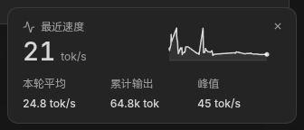
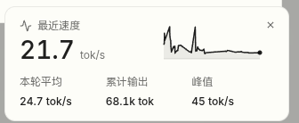
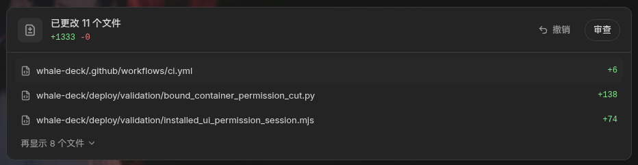
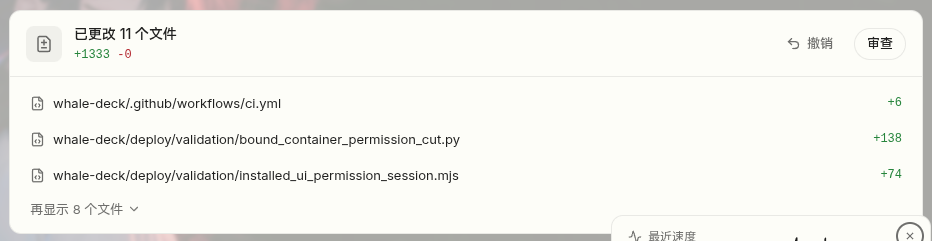

# Whale Deck 前端视觉规范与实施计划

日期：2026-10-30。依据用户提供的四张明暗主题参考图，并明确要求纳入当前计划与Markdown文档。

状态：**已纳入计划，样式改造待实施、待真实页面验收**。归属现有P0-08，关联P0-03/P0-07、P1/P2业务页面及P5-05/P5-10；当前59个主任务稳定ID不变。按实际页面直接实现，不增加独立原型审批阶段。

## 1. 参考与视觉方向

2026-10-30后续追加：[C#酒馆与AI看板娘](AI_TAVERN_MASCOT.md)原生聊天、配置与余额/额度卡沿用此视觉规范。看板娘动画、物理、碎碎念/对话和睡眠有独立PET验收，不用静态卡片替代；不遮确认框/终端，不占用表单快捷键，减少动画/静音/隐藏/睡眠分别可配置。此追加归现有P4-08/P0-08/P5-05子范围，均待实现与真实页面验收。

同日后续：[统一供应商/Live2D对话页](AI_PROVIDERS_LIVE2D.md)沿用上述卡片与主题；Live2D舞台是角色渲染，聊天/停止/配置仍有可访问的DOM控件。AI动作受用户优先级、减少动画和睡眠仲裁；正常对话页不得用透明视频或静态头像充当Live2D完成。

目标是“紧凑但不拥挤、信息层级清楚”：中性卡片工作面、柔和圆角、轻边框、克制配色；主数据突出，单位和辅助说明弱化，趋势与次要数据保持可读。

以下为用户原始参考截图，按原文件保存，便于后续实现与复核；参考图本身不是Whale Deck已实现或验收通过的证据。

### 指标卡：深色与浅色

### 变更摘要：深色与浅色

## 2. 统一卡片语言

- 复用Vue3/Element Plus组件与主题变量，工作面、边框、主/次文字、交互状态均随主题切换；圆角、间距和字号集中使用设计变量，避免逐页硬编码色值。
- 卡片标题、主要数字、单位、辅助指标形成明确层级；大数字采用稳定的数字宽度，数值刷新时减少布局跳动。图标为识别和操作服务，辅助信息使用较弱强调。
- 主要动作清楚可见；次要操作采用轻量按钮或文字按钮。展开、关闭、刷新等控件保持可点击区域、键盘焦点与可访问名称。
- 保留现有Whale Deck品牌、固定半透明顶栏及滚动过渡、侧栏断点、明暗/系统主题、字体和减少动画支持。
- 高风险确认仍完整显示作用对象、原值与目标值、范围、影响、备份/恢复事实、当前任务状态及错误原因。摘要折叠不能隐藏确认所需信息。
- 沿用现有权限裁剪和功能边界；撤销/恢复动作仅连接实际支持的业务能力，发布流程继续遵守dev修复后覆盖、不自动回滚的既有约定。

## 3. 指标卡

结构：顶部简短标题；主体为左侧当前值与单位、右侧小趋势图；底部为窗口平均、累计、峰值或其他有实际意义的次指标。

- 用于CPU、内存、网络、磁盘I/O、容器统计、备份/任务进度等已有真实数据；各指标使用正确单位、精度与时间窗。底部字段按指标语义选择，不强行凑齐三项。
- 小图使用真实采样/聚合序列；缺口断开，过期、离线、加载、空值、错误均有明确状态，不能用0或补点伪装连续数据。
- 有足够空间时主数值与小图并列，窄屏空间不足时换行；次指标不能因压缩而截断单位或关键标签。提供可读文本，不能只依赖曲线或颜色表达状态。

## 4. 任务与变更摘要卡

结构：顶部图标、任务/变更标题、数量/结果汇总和少量操作；下方为紧凑条目，右侧显示状态或变化量，末尾提供剩余数量和展开入口。

- 摘要默认展示少量条目（通常3条，按业务预算调整），用“再显示N项”等明确入口展开；完整资源列表继续保留原有搜索、分页与筛选。
- 文件名、资源名、路径和任务ID按重要性有界换行或省略，鼠标、键盘和触摸均能查看完整值；状态与操作保持对齐，长文本不挤压主要按钮。
- 任务卡关联原任务与真实事件，区分等待、执行、已取消、失败、Unknown、历史已完成等事实；变化量的增减需有文字/符号，不能只有颜色。
- 变更确认页面保留原值→目标值、字段差异及明确确认。Unknown与部分失败继续展示已知/未知事实、保留保护和恢复入口，不能被统一“成功”摘要覆盖。

## 5. 当前实施顺序与页面映射

以下为P0-08内部工作包，不增加P0–P5主任务数量。当前所有者功能全链和其余文件任务继续推进；新增页面按本规范实现，已有页面分批迁移，不因视觉改造暂停原业务。

| 工作包 | 对应页面/阶段 | 交付与验收 | 状态 |
| --- | --- | --- | --- |
| DEV-UI-001 | P0-08共用样式 | 统一卡片边框/圆角/间距/文字层级/按钮状态，明暗及系统主题一致，保留现有顶栏与侧栏 | 待实施 |
| DEV-UI-002 | P0-07/P0-08概览、主机与容器监控 | 当前值+真实小趋势图+适用次指标；验证缺口/过期/离线、单位与原数据对应 | 待实施 |
| DEV-UI-003 | P0-03、P1/P2任务及变更确认，含当前所有者/文件流程 | 摘要与展开、长路径、原任务接续、原值/目标值、取消/失败/Unknown及权限裁剪可用 | 待实施 |
| DEV-UI-004 | P0-08全页、P5-05/P5-10主题和整站验收 | 逐页迁移并完成真实浏览器、窄屏/桌面、明暗、键盘和减少动画回归，记录版本与截图 | 待实施 |

## 6. 验收要求

1. 320、1045、1440、1920px及明暗/系统主题下，整页无横向溢出；标题、数值/单位、路径、展开/关闭和确认按钮均可用。验证主题动态切换、侧栏与顶栏滚动行为。
2. 指标值和趋势与真实接口/采样窗口对应；任务与变更摘要能定位原记录。加载、空、长文本、错误、403、401/会话过期、离线及Unknown不能仅验证截图外观。
3. 展开/折叠、刷新、查询、取消、确认和恢复等实际已有动作保持正确；样式变化不得引入重复登记、重复确认、权限放宽或私有内容残留。
4. 验证键盘顺序、焦点、可访问名称、文字对比与减少动画；触摸设备可查看完整省略内容，图表提供文字信息。
5. 执行与变更相关的前端单元/类型/lint/格式/生产构建和浏览器回归；部署后以真实身份、真实数据操作对应页面，并保留源码/运行版本、明暗截图及交互证据，才标记该工作包通过。

文档与参考图纳入计划不计作UI实现完成，也不改变当前已部署版本。
