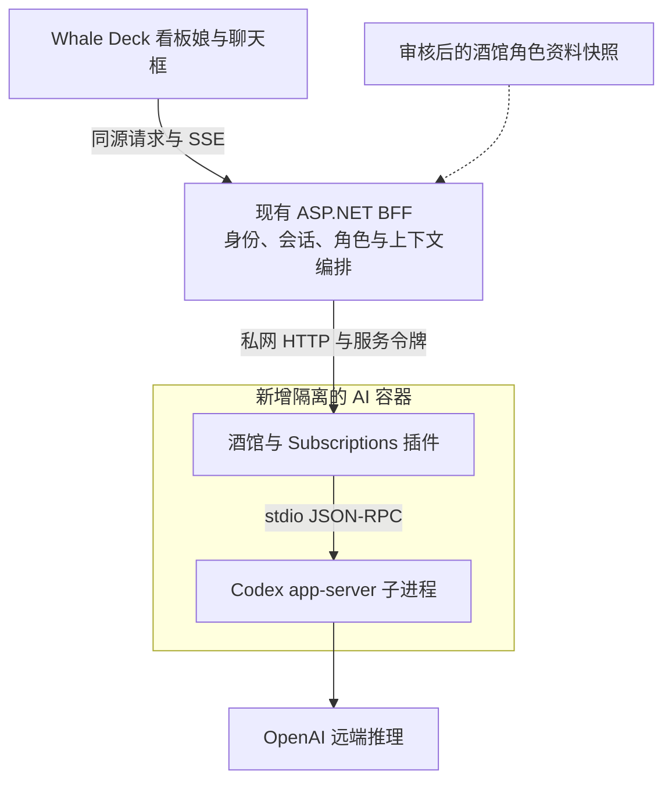

# Whale Deck AI 看板娘：酒馆、Codex CLI 与 Docker 接入调研

> 2026-10-30后续决定：本文保留为早期桥接路线研究。用户现要求**C#重构酒馆后端、Vue集成完整酒馆功能/配置和dsh-pet风格看板娘**，并纳入现有59项子计划；以下“仅调研、不修改活动范围”“先最小链路”不再作为当前产品限制。当前方案、权限/依赖/失败恢复与逐项验收见[AI_TAVERN_MASCOT.md](../AI_TAVERN_MASCOT.md)和[完整账本](../AI_TAVERN_ACCEPTANCE.md)。此前Codex CLI接入方向保留为首批待验证模型适配之一，Subscriptions是历史候选实现，最终不以运行原酒馆Node服务替代C#重构；下方组件与授权信息是当时调研事实，实施时须按实际固定版本复核。

日期：2026-10-30。状态：文档与关键源码调研完成；未构建镜像、未运行模型请求、未部署、未验证容器运行效果。

用户目标：在 Whale Deck 前端加入角色化 AI，最好具有看板娘效果；后端采用 SillyTavern（酒馆）连接 Codex CLI，并在 Docker 中运行。本报告是新增方向的可行性研究，不修改当前 59 项活动目标，也不代表已授权生产部署或 AI 控制工作站。

## 1. 结论

技术链路可实现，但需要产品适配，不能只拼接三个现成服务：

- 酒馆可以容器化。Subscriptions 插件实际调用本地 Codex app-server，并把其文本增量转换为 OpenAI 兼容 SSE。
- 插件提供的是模型桥接接口。调用这个接口不会自动执行完整的酒馆角色卡、世界书、预设和历史编排。
- 现成插件通过 `spawn` 启动 Codex，最少改动的部署单位是一个包含酒馆、插件及 Codex CLI 的专用容器。把 CLI 独立为普通 sidecar 后不能直接沿用此实现。
- Whale Deck 的 Vue/Element Plus 前端可以承载立绘或 Live2D。角色渲染发生在浏览器，不需要在服务器运行图形桌面。
- 订阅身份用于容器化应用的适用范围必须单独确认；技术连通不等于获得商用或托管服务授权。

建议先验证“看板娘纯对话 + 酒馆角色资料的明确兼容子集 + 订阅桥接”的最小链路，保留后端替换入口。若要求完整复现酒馆插件生态与世界书行为，应先完成酒馆编排层的专门技术验证，再决定实施。

## 2. 锁定的调研基线

| 组件 | 核对版本或提交 | 说明 |
| --- | --- | --- |
| Whale Deck | `2a9ceb6c8bd370466b6828ffdaef2faa3ed4dd7c`，`dev` | 当前仓库只读检查基线 |
| SillyTavern | `1.19.0`；`06bde939fb1e9c4c8d8641d810f0a916b5bce127` | 当日 `release` 分支解析结果 |
| SillyTavern-Subscriptions | `3.1.0`；`46fe9ceaae31e6f4274d577cf222901f5b92f099` | 核对监听器、请求设置、消息转换、Codex 子进程实现 |
| 当前环境 Codex CLI | `0.159.2` | 仅运行 `--version` / 帮助；不是 Docker 联调证据 |
| Cubism Web Framework | `d4da0aa07e47d2c1e4f5fa7ea6047861ea5e5d0b` | 看板娘渲染候选，尚未集成 |

CLI、酒馆和插件的这个组合尚未实测。部署应固定已验证的组合、依赖锁文件及镜像 digest，不能采用启动时自动拉取 `latest` 的方式。

## 3. 最关键的边界：酒馆不是现成的无界面角色服务

在所核对的酒馆版本中，浏览器侧 `public/script.js` 的 `Generate()` 调用 `getWorldInfoPrompt()`；`public/scripts/openai.js` 的 `prepareOpenAIMessages()` 编排角色描述、世界书和提示词，然后向服务器的 `/api/backends/chat-completions/generate` 提交请求。这说明正常聊天链路中的关键编排存在于前端。

来源：[Generate / 世界书调用](https://github.com/SillyTavern/SillyTavern/blob/06bde939fb1e9c4c8d8641d810f0a916b5bce127/public/script.js#L4290)、[消息编排与生成请求](https://github.com/SillyTavern/SillyTavern/blob/06bde939fb1e9c4c8d8641d810f0a916b5bce127/public/scripts/openai.js#L1542)。

Subscriptions 则接收已经组装好的 `messages`，抽取前导 system 消息，其余历史折叠为有标签的文本，启动临时 Codex thread。它没有在这个入口按角色 ID 自动读取并执行整个酒馆编排流程。[消息处理](https://github.com/LukaTheHero/SillyTavern-Subscriptions/blob/46fe9ceaae31e6f4274d577cf222901f5b92f099/lib/common/messages.js)、[Codex 聊天实现](https://github.com/LukaTheHero/SillyTavern-Subscriptions/blob/46fe9ceaae31e6f4274d577cf222901f5b92f099/lib/codex/chat.js)

未发现官方文档承诺一个稳定的“提交角色 ID、聊天 ID，即执行完整酒馆对话”的公开 headless API。该结论限定为本次文档与选定源码检查；不声称所有社区扩展均不存在此能力。官方 server plugin 可以增加 Express 路由，但新增路由仍需自行实现编排，并受其宿主中间件影响。[官方扩展契约](https://docs.sillytavern.app/for-contributors/server-plugins/)

| 接法 | 获得的能力 | 代价与适用性 |
| --- | --- | --- |
| 保留完整酒馆 UI，做主题或 UI 扩展 | 复用酒馆现有编排与生态 | Whale Deck 原生看板娘体验受限；嵌入、登录和代理路径需另测 |
| Whale Deck 自定义 UI，BFF 编排明确的角色资料子集，调用酒馆插件 | 原生看板娘、可控历史、可接入页面上下文 | **推荐先验证**；世界书触发和预设兼容范围需自己定义 |
| 为酒馆增加 headless 编排层 | 更接近完整酒馆行为 | 需提取或重构前端依赖、锁定内部接口、维护兼容；不属于现成配置工作 |

不建议为了让后端“像浏览器一样”调用 `Generate()` 而在生产聊天链路里依赖隐藏页面和浏览器自动化。

## 4. 建议架构与现有仓库接入点

以下是第二种接法的建议结构，尚未实现：

图中角色资料快照是拟建设的导入协议，不是酒馆现成的动态同步 API。需要约定角色卡、世界书、预设的版本和生效方式；禁止运行角色卡携带的脚本或直接渲染不受信任的 HTML。

| 现有位置 | 已核对行为 | 后续接入建议 |
| --- | --- | --- |
| `web/src/layouts/AppShell.vue` | 全局导航与路由页面壳 | 加全局看板娘挂载点；聊天面板按需加载，可收起，避免遮挡终端/文件操作 |
| `web/src/router/index.ts` | Vue Router 页面入口 | 需要完整历史时增加独立对话页；路由为建议，当前不存在 |
| `web/src/services/apiClient.ts:69` | JSON 客户端，固定 15 秒超时 | 新增独立流式客户端，复用 cookie/CSRF/错误处理，不直接复用 JSON 返回逻辑 |
| `src/WhaleDeck.Api/Program.cs:84` | 服务端 OIDC 会话、HttpOnly cookie、认证兜底 | BFF 继续拥有身份；AI 服务不读取 Authentik 凭据或浏览器 OIDC token |
| `src/WhaleDeck.Api/Controllers/JobsController.cs:35` | SSE、flush、`X-Accel-Buffering: no` | 借鉴传输经验；不要把 Job 流的一分钟轮换直接复制为重新生成聊天的逻辑 |
| `deploy/gateway/nginx.conf:112` | 通用 API 反代，无该 location 专用流式超时设置 | 增加聊天流的缓冲/超时配置，并真实测量首段文本是否及时到达 |

保持 `Domain → Application → Infrastructure → Api/Worker` 分层：角色/上下文/会话用例归 Application，外部 AI HTTP 适配归 Infrastructure，Controller 只处理传输。需要保存会话时再定义数据模型与 EF migration，按 Authentik subject 做会话归属，不增加本地密码或重复用户资料。

前端只提交允许的聊天字段，模型、订阅 backend、服务地址、服务令牌由 BFF 决定。服务器从已授权数据读取页面上下文，不能信任浏览器声称的管理员权限。初期建议仅陪聊和经授权的只读解释；容器操作或宿主终端权限另立用例。

## 5. Docker 接法

官方酒馆支持 Docker，并提供配置、数据、插件和前端扩展的持久目录。[官方 Docker 文档](https://docs.sillytavern.app/installation/docker/)

### 容器和进程

保持现有 gateway、API、Worker 的职责，新增独立的 AI 服务镜像；在其内固定安装酒馆、Subscriptions 与 Codex CLI。插件实际以 `spawn(..., ['app-server', '--stdio', ...])` 创建本地进程，因此同一镜像可先避免额外的远程 app-server 适配。[本地进程实现](https://github.com/LukaTheHero/SillyTavern-Subscriptions/blob/46fe9ceaae31e6f4274d577cf222901f5b92f099/lib/codex/app-server.js#L111)

使用非 root、受限可写目录、`no-new-privileges`、资源限制和受控日志。现成上游 Dockerfile 基于 Alpine，需验证固定 CLI 版本及原生依赖在该基础镜像与目标架构下可执行；有兼容问题时可自建 Debian slim 镜像，不能未经测试宣称 Alpine 必然不支持。

生产镜像应在构建时放入已审核插件与锁定依赖，不在启动时自动更新仓库。上游示例挂载整个空 plugins 目录可能遮蔽镜像内插件；采用自定义布局时需要处理该问题。[上游 Dockerfile](https://github.com/SillyTavern/SillyTavern/blob/06bde939fb1e9c4c8d8641d810f0a916b5bce127/Dockerfile)、[上游 Compose](https://github.com/SillyTavern/SillyTavern/blob/06bde939fb1e9c4c8d8641d810f0a916b5bce127/docker/docker-compose.yml)

### 网络

- 新增仅 BFF 与 AI 服务共享的内部网络。AI 服务另有必要的出站网络访问 OpenAI；仅加入 `internal: true` 网络会妨碍远端推理。
- 不发布酒馆 `8000`、插件 `8901` 或 Codex app-server 的宿主端口。容器间通过服务 DNS 访问，`expose` 不是身份鉴权或防火墙。
- 插件默认监听容器自己的 `127.0.0.1:8901`，BFF 所在容器不能据此访问它。跨容器需要 `ST_SUBSCRIPTIONS_HOST=0.0.0.0`，并设置服务端 `ST_SUBSCRIPTIONS_TOKEN`，BFF 每次携带 `X-Subscriptions-Token`。
- 固定提交中，loopback 模式使用 Host 校验，非 loopback 模式使用令牌校验；不是两种模式都必须额外配置 allowed hosts。
- 如保留酒馆管理 UI，单独规划管理员入口及其 cookie、CSRF、白名单和反代行为，不直接复制上游 `8000:8000` 发布方式。

来源：[插件访问控制和启动检查](https://github.com/LukaTheHero/SillyTavern-Subscriptions/blob/46fe9ceaae31e6f4274d577cf222901f5b92f099/lib/listener.js#L120)、[Docker 服务发现](https://docs.docker.com/compose/how-tos/networking/)。

AI 容器不加入 PostgreSQL/Valkey/Authentik 管理网络，不挂载 Docker socket、宿主 Agent socket、真实仓库或宿主用户目录。网络与出站策略需要与工作站现有 Docker 隔离规则共同验证。

### 持久化和登录

| 数据 | 建议位置与生命周期 |
| --- | --- |
| 酒馆配置、角色卡、世界书、原生聊天 | 独立配置/数据卷；按既有备份策略管理 |
| 专用 `CODEX_HOME` | 仅 AI 服务可读写的独立卷；凭据刷新需要写入；不复用整个宿主 `.codex` |
| Whale Deck 聊天与已使用角色版本 | 由 Whale Deck 定义归属/删除/保留策略；避免两边同时无约束地写同一份历史 |
| CLI 日志、缓存与临时 cwd | 受控空间和保留期限；不能让隐藏文件日志绕过已有容器日志上限 |
| 插件与前端扩展代码 | 优先随版本化镜像发布；更新和回滚可追踪 |

专用 `CODEX_HOME` 防止加载开发用 AGENTS.md、MCP、插件及其他身份配置。容器登录优先评估 `codex login --device-auth`；设备授权由用户在浏览器完成。无头环境也有官方凭据缓存迁移路径，但不能把凭据放入镜像、Git、前端或调研日志。[官方无头登录说明](https://learn.chatgpt.com/docs/auth#login-on-headless-devices)、[CODEX_HOME 说明](https://learn.chatgpt.com/docs/config-file/environment-variables)

## 6. Codex 桥接的实际能力与限制

- 使用 app-server 的文本增量；支持停止信号及临时 thread。官方 CLI 参考仍标记 app-server 为 Experimental，必须固定和验证协议版本。[官方 CLI 参考](https://learn.chatgpt.com/docs/cli/reference)
- 所选插件的订阅路径拒绝 API-key 身份，关闭工具，并检查外部代理指令。聊天历史由调用方传入；临时 thread 不等于持久会话记忆。[插件实现](https://github.com/LukaTheHero/SillyTavern-Subscriptions/blob/46fe9ceaae31e6f4274d577cf222901f5b92f099/lib/codex/chat.js)
- BFF 应显式固定 `subscriptions.codex.backend` 为 `subscription`，并限定允许的模型；不能透传任意 provider、Auto、服务 URL 或客户端密钥字段。[设置解析](https://github.com/LukaTheHero/SillyTavern-Subscriptions/blob/46fe9ceaae31e6f4274d577cf222901f5b92f099/lib/settings.js#L45)
- 不应假定酒馆所有采样参数与输出长度上限都会传到 CLI；订阅路径没有对应 `max_tokens` 的完整映射。需验证响应时长/展示长度/取消策略，不能把客户端截断当作严格的推理 token 预算。
- 订阅额度、速率限制、登录过期和模型实际可访问性都需要真实请求验收；不能凭模型列表认定已获访问权限。

### 授权与发布边界

OpenAI 当前 app-server 文档明确区分已有 local/open-source 客户端与 commercial/hosted services，并引导新应用考虑 Sign in with ChatGPT。容器部署不自动授予服务化权限，也不能仅凭“内网”就推断适用豁免。本人工作站自用的具体部署仍应确认适用条件；若计划对外或给多人提供托管服务，应评估官方 Sign in with ChatGPT 路径或 API 计费后端。[官方说明](https://learn.chatgpt.com/docs/app-server#auth-endpoints)、[Sign in with ChatGPT](https://developers.openai.com/siwc)

Subscriptions 声明 `AGPL-3.0-or-later`。修改、分发或提供其网络服务前需核对对应许可义务；本报告不据此判断整个 Whale Deck 的许可证归属。[项目许可声明](https://github.com/LukaTheHero/SillyTavern-Subscriptions/blob/46fe9ceaae31e6f4274d577cf222901f5b92f099/package.json#L12)

## 7. 看板娘表现

| 方式 | 能呈现的效果 | 建议 |
| --- | --- | --- |
| 多表情透明立绘 | 待机、思考、回复、错误表情；轻量呼吸/切换动画 | 没有绑定模型时先用它验证体验，后续保持相同渲染接口 |
| Live2D Cubism Web | 眨眼、视线、动作、表情与可选口型 | 有适用的 `.model3.json`、`.moc3`、贴图及动作资源后接入 |
| VRM/3D | 更丰富空间表现 | 当前管理面板场景收益不明确，暂不作为首选 |

状态机先采用 `idle → thinking → responding → idle/error`，由真实请求状态驱动。情绪映射后续采用受限枚举；不要让模型输出任意脚本。TTS 和口型属于额外能力，Codex 文本桥接并不自动提供。

Live2D 官方 Web Framework 配合 Core 在浏览器渲染。常见 `guansss/pixi-live2d-display` 当前所核对 README 依赖 PixiJS 6 和 Cubism Core 2.1/4，不能未经验证与最新 Pixi/Cubism 组合。优先核对模型版本后选择官方 Framework 或相匹配的封装，并固定版本。[官方 Framework](https://github.com/Live2D/CubismWebFramework/tree/d4da0aa07e47d2c1e4f5fa7ea6047861ea5e5d0b)、[封装的版本要求](https://github.com/guansss/pixi-live2d-display/tree/31317b37d5e22955a44d5b11f37f421e94a11269)

SDK 发布条件与模型素材使用条件分别核对，不把公开下载当作任意再分发许可。[SDK 发布说明](https://www.live2d.com/en/sdk/license/)

延续 Whale Deck 现有深浅主题和 reduced-motion 支持。桌面可放可收起的角落角色，手机收为按钮/底部面板；页面隐藏或角色收起时暂停渲染，WebGL 失败降级立绘，素材和模型库延迟加载。不要让看板娘遮挡确认、终端或文件操作。

## 8. 后续最小验证顺序

以下均为建议验收项目，不表示已执行：

1. 固定镜像/酒馆/插件/CLI 组合，确认非 root 启动、进程退出、只允许预期可写目录。
2. 在独立数据卷完成登录，验证中文生成、实时 SSE、停止/断开后上游 interrupt、认证失效和限额错误；重建容器后再次请求。
3. 验证容器 DNS、非 loopback 令牌检查、无宿主端口、出站路径，以及现有 Gateway/BFF 的流式缓冲与超时。
4. 对选定角色卡和世界书构造样例，比较酒馆原生结果与 Whale Deck 编排后的**输入消息结构**；列出支持/不支持字段，不只比较模型最终措辞。
5. 验证会话归属、切换角色、编辑/删除历史后的上下文，以及不会共享其他用户私有数据。只读工作站上下文按服务器权限取数。
6. 最后接看板娘素材，检查 320px 手机宽度、深浅主题、减少动画、收起和页面隐藏后的资源占用。

测量首段可见文本时间、完成耗时、取消后停止时间、容器内存峰值与前端帧率。当前没有足够证据给出可靠的性能数字、内存承诺或工期估计。

## 9. 本轮交付范围

已核对本地前端、BFF、SSE、Docker 约束；检查上游固定提交的核心实现；明确完整酒馆编排与模型桥接的边界，形成上述接入建议。尚未决定最终 UI 美术、完整世界书兼容范围、服务化授权方案；未安装插件、未读取或迁移 Codex 凭据、未构建或部署服务，也未扩大 59 项活动范围。

后续范围结论（2026-10-30）：以上“未扩大59项”“先最小链路”“UI形式未定”为早期记录，现已由用户明确的[C#完整酒馆](../AI_TAVERN_MASCOT.md)与[统一供应商/AI驱动Live2D](../AI_PROVIDERS_LIVE2D.md)覆盖。历史组件研究保留，不能据此缩减当前移植/配置/Live2D验收。
